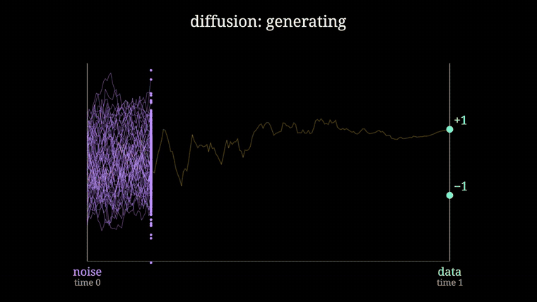
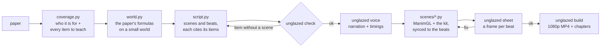
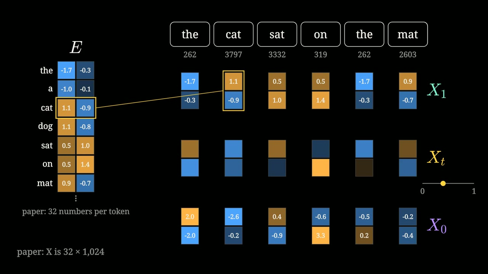
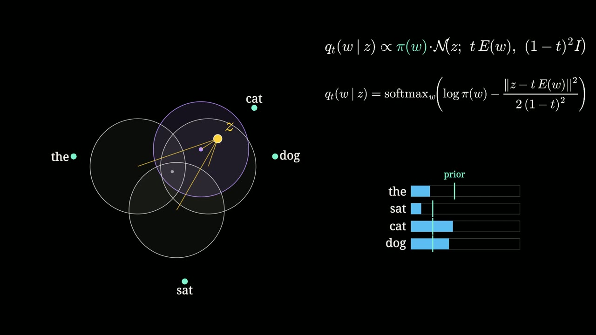
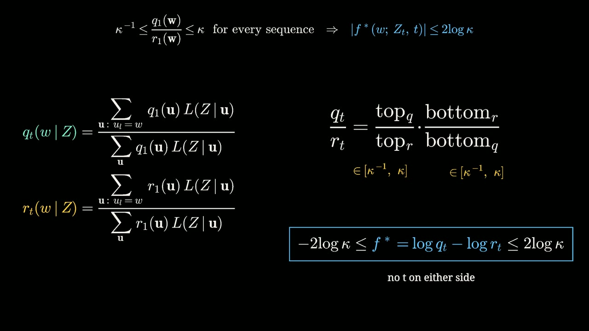
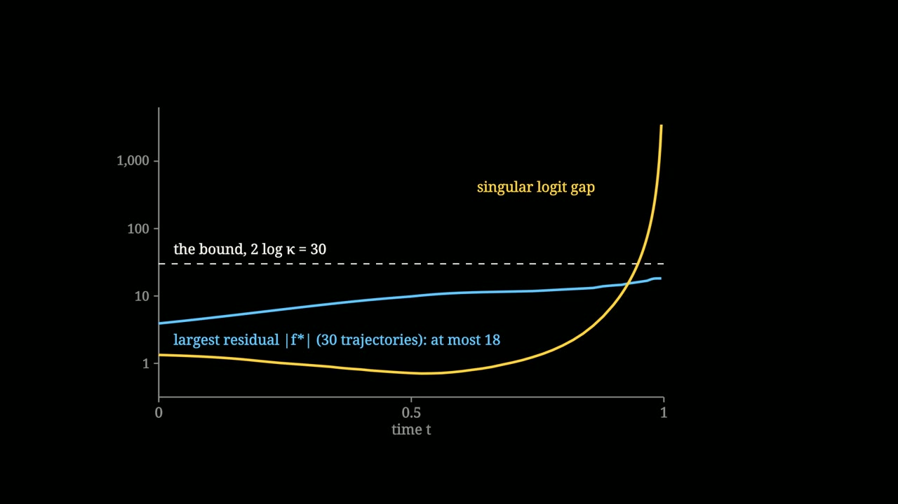

<h1 align="center">unglazed</h1>

<p align="center">
  <b>Turn an ML paper into a narrated, animated explainer that derives every step, and refuses to build if it skips one.</b>
</p>

<p align="center">
  <a href="https://github.com/ShadowKingYT444/unglazed/actions/workflows/ci.yml"></a>
  
  <a href="LICENSE"></a>
  
  
</p>

<p align="center">
  <a href="https://github.com/ShadowKingYT444/unglazed/releases/download/v0.1.0/Flow_Matching_on_Text_every_step.mp4">
    
  </a>
</p>

<p align="center">
  <b><a href="https://github.com/ShadowKingYT444/unglazed/releases/download/v0.1.0/Flow_Matching_on_Text_every_step.mp4">Watch the full demo (29 min, 1080p)</a></b>
  · made with this repo from <a href="examples/relf"><code>examples/relf</code></a>
</p>

---

Most explainer tools check that a video **renders**. `unglazed` also checks that it **teaches**: you list every
mechanism, equation and number the video must cover, and the build fails while one of them has no scene.
The pictures are computed with the paper's own formulas, so nothing on screen is a sketch.

## Install

```bash
uv tool install "unglazed[voice] @ git+https://github.com/ShadowKingYT444/unglazed"
```

You also need `ffmpeg`, and a GPU that Vulkan (Linux) or Metal (macOS) can see. Then test the install:

```bash
unglazed demo
```

<details>
<summary>Details: no uv, no GPU, fonts, voice</summary>

- **No uv:** `pipx install "unglazed[voice] @ git+https://github.com/ShadowKingYT444/unglazed"` works too.
  [Get uv](https://docs.astral.sh/uv/) with `curl -LsSf https://astral.sh/uv/install.sh | sh`.
- **No GPU:** ManimGL draws through wgpu. On Linux without a GPU driver, install Mesa's software Vulkan
  (`sudo apt install mesa-vulkan-drivers`) and work with `--draft`.
- **Fonts:** text uses Noto Serif and DejaVu Sans Mono (`sudo apt install fonts-noto-core fonts-dejavu-core`).
  Set `UNGLAZED_FONT` / `UNGLAZED_MONO` to use others. Math needs no LaTeX install.
- **Voice:** narration is [Kokoro](https://github.com/hexgrad/kokoro), local, no API key. Leave out `[voice]` to skip
  the PyTorch download; you can still draft everything with `--estimate`. `--voice my_voice.pt` uses your own voice pack.
  Set `UNGLAZED_TTS_PYTHON` to run the voice in another Python that already has kokoro.
</details>

## Sixty seconds

```bash
unglazed new myvideo                      # a video folder from the template
unglazed check myvideo                    # the depth check
unglazed voice myvideo --estimate         # timings without a voice (silent draft)
unglazed render myvideo s01 --draft       # 480p draft of one scene
unglazed sheet myvideo s01 --draft        # one frame per beat, to check it by eye
unglazed build myvideo                    # check + voice + 1080p render + join -> build/myvideo/myvideo.mp4
```

To rebuild the demo video (about 25 minutes of rendering on a laptop GPU):

```bash
git clone https://github.com/ShadowKingYT444/unglazed && cd unglazed
unglazed build examples/relf
```

## How it works



A video is one folder:

| File | What goes in it |
|---|---|
| `coverage.py` | The brief (what the viewer knows, what they can do afterwards, what to skip) and the list of items to teach, each with its place in the paper |
| `world.py` | A world small enough to compute exactly with the paper's formulas. Every number on screen comes from here or from the paper |
| `script.py` | The narration: scenes made of beats. Each scene names the coverage items it teaches |
| `scenes/*.py` | One class per scene. `self.at(i)` waits for narration beat `i`, so picture and voice stay together |

The full method, with the rules that came out of making the demo, is in [docs/METHOD.md](docs/METHOD.md).
The look and the pacing are in [docs/STYLE.md](docs/STYLE.md).

## The depth check

```text
$ unglazed check examples/relf
item         scenes           source                   what
vel          s02              Sec. 2, Eq. 1-2          v* = E[X1 - X0 | X_t] = (E[X1 | X_t] - X_t) / (1 - t), derived
thm          s11              Thm 3.1 / A.1            if 1/kappa <= q1/r1 <= kappa then |f*| <= 2 log kappa for all t < 1
sched        s16              Sec. 3.2, App. B.1       training times sampled uniformly in the arc length ...  [not read word for word]
...
35 items, 35 covered, 24 scenes, 4192 words (about 29 minutes)
```

Delete a scene and the command exits with an error and names the items that are no longer taught.
Length is an output of this list. A short video comes from a short list, never from cutting.

## The kit

`from unglazed.kit import *` inside a scene file gives you:

| Piece | For |
|---|---|
| `BeatScene` | Scenes that wait for narration beats: `self.at(i)`, `self.dur(i)`, `self.chapter(...)` |
| `Heat` | A matrix as coloured cells with its numbers; recolours live |
| `CodePanel` | The code the viewer should be able to write, with the current line lit |
| `M`, `Tx`, `ladder` | Math without a LaTeX install, serif labels, stacked derivations |
| `Plot`, `BarChart`, `Bars` | Curves, ablation charts, live probability bars |
| `Space`, `Cloud`, `Paths`, `Field` | Thousands of points following a precomputed trajectory, their trails, arrow fields |
| `Tile`, `Flipbook` | Real pixels (numpy arrays), still or as a sequence |
| `Chip`, `token_row`, `ModelBox`, `TimeBar`, `halo` | Tokens, networks, the clock, noise clouds |

`unglazed.sims` has exact flow-matching math for finite data (posterior, guess, velocity, Euler paths, reflow), numpy only.

<p align="center">
  
  
  
  
</p>

## Use it with a coding agent

[`skills/unglazed/SKILL.md`](skills/unglazed/SKILL.md) is a skill file for Claude Code and other coding agents.
It tells the agent to read the paper, write the coverage list first, and look at a frame of every beat before rendering.

```bash
mkdir -p ~/.claude/skills && ln -s "$PWD/skills/unglazed" ~/.claude/skills/unglazed
```

Then ask: *"Use the unglazed skill to make a full technical explainer of this paper: <arXiv link>."*

## The demo video

**Flow matching on text, every step** explains [Rectified Language Flow](https://arxiv.org/abs/2610.33811)
(Su, Liao, Chen, Liu) for someone who knows diffusion and wants to implement the method:

| | |
|---|---|
| 0:00 | The two loops you will be able to write |
| 2:04 | 1. The state: text as a matrix, the token posterior, the soft token |
| 5:56 | 2. Training with cross entropy, and the sampling loop |
| 8:29 | 3. Singular logits, with the proof of the bounded-residual theorem |
| 14:24 | 4. The embedding table: Hellinger distance, SVD, the dimension ablation |
| 18:20 | 5. Self-conditioning, guidance in logit space, and how it is trained into one pass |
| 22:29 | 6. The stochastic sampler and reflow |
| 24:59 | 7. The model, the results, and what each part becomes in a looped model |

Its toy language runs the paper's own embedding recipe on 12 sentences, and the theorem is checked on it
(`examples/relf/world.py`). Numbers quoted from the paper are from arXiv version 1.

## What this is not

It is not a prompt-to-video button. You (or your agent) still write the script and the scenes.
The repo gives you the contract that keeps the video honest, a kit that makes technical scenes short to write,
and the plumbing (voice, sync, render, checks, assembly).

## Related work

[Code2Video](https://github.com/showlab/Code2Video) and
[TheoremExplainAgent](https://github.com/TIGER-AI-Lab/TheoremExplainAgent) generate Manim videos from a topic with agents.
[manim-skill](https://github.com/Yusuke710/manim-skill) and
[explainer-video](https://github.com/manoletre/explainer-video) are agent skills for narrated Manim videos.
`unglazed` adds the part they leave open: a checked list of what the video has to teach, and pictures computed from the source.
Built on [ManimGL](https://github.com/3b1b/manim) by Grant Sanderson and [Kokoro](https://github.com/hexgrad/kokoro).

## License

[MIT](LICENSE). The demo video explains a paper by other authors; all results in it belong to them.
