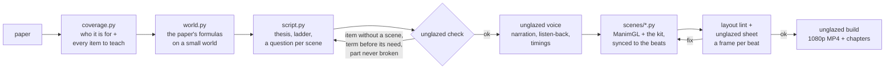
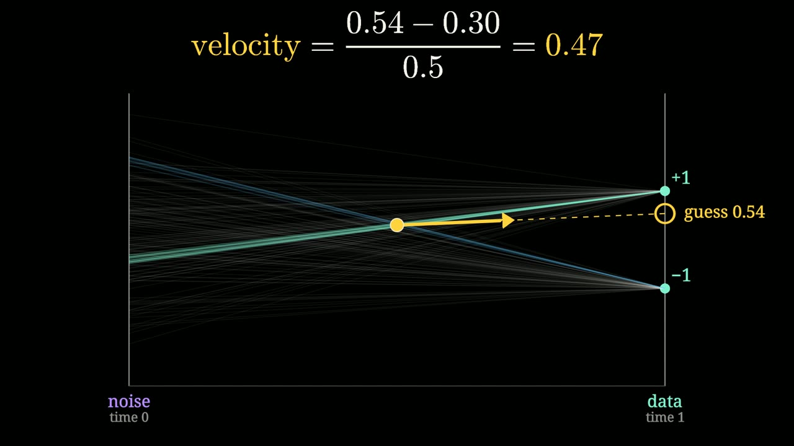
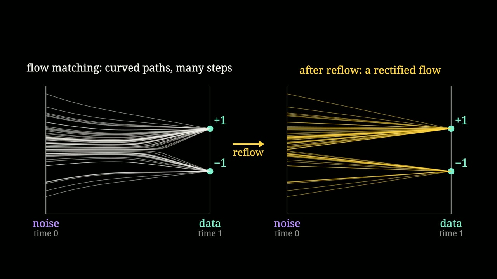
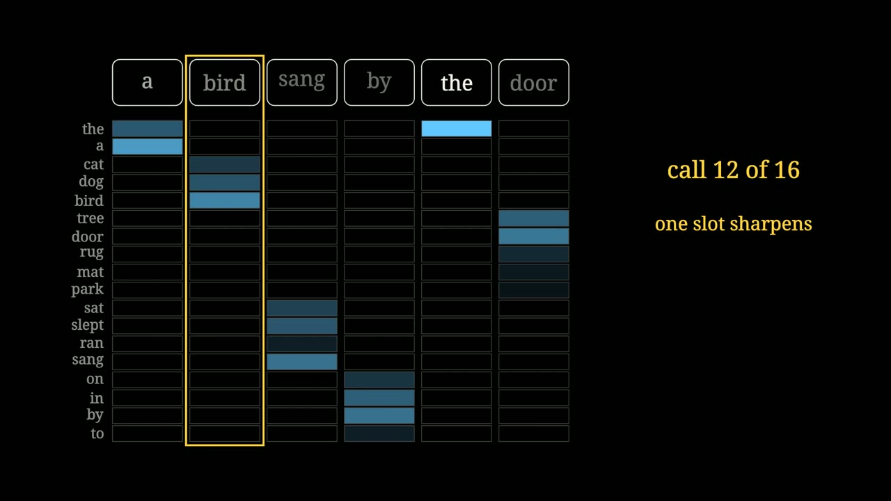

<h1 align="center">unglazed</h1>

<p align="center">
  <b>Turn an ML paper into a narrated, animated explainer that derives every step, and refuses to build if it skips one or teaches it badly.</b>
</p>

<p align="center">
  <a href="https://github.com/ShadowKingYT444/unglazed/actions/workflows/ci.yml"></a>
  
  <a href="LICENSE"></a>
  
  
</p>

<p align="center">
  <a href="https://github.com/ShadowKingYT444/unglazed/releases/download/v0.2.0/Rectified_flow_from_scratch.mp4">
    
  </a>
</p>

<p align="center">
  <b><a href="https://github.com/ShadowKingYT444/unglazed/releases/download/v0.2.0/Rectified_flow_from_scratch.mp4">Watch the full demo (31 min, 1080p)</a></b>
  · made with this repo from <a href="examples/rectflow"><code>examples/rectflow</code></a>
</p>

---

Most explainer tools check that a video **renders**. `unglazed` also checks that it **teaches**:

- **Depth.** You list every mechanism, equation and number the video must cover. The build fails while one has no scene.
- **Teaching.** The script declares one thesis, a ladder of small worlds, and a question for every scene. The build
  fails if a term is spoken before the viewer needs it, or if a part of the method is never shown breaking.
- **Truth.** The pictures are computed with the paper's own formulas on a small world, so nothing on screen is a sketch.
- **Craft.** Narration is local, transcribed back and retaken where it came out wrong. Layout is linted on every beat.

## Install

```bash
uv tool install "unglazed[voice] @ git+https://github.com/ShadowKingYT444/unglazed"
```

You also need `ffmpeg`, and a GPU that Vulkan (Linux) or Metal (macOS) can see. Then test the install:

```bash
unglazed demo
```

<details>
<summary>Details: no uv, no GPU, fonts, voice</summary>

- **No uv:** `pipx install "unglazed[voice] @ git+https://github.com/ShadowKingYT444/unglazed"` works too.
  [Get uv](https://docs.astral.sh/uv/) with `curl -LsSf https://astral.sh/uv/install.sh | sh`.
- **No GPU:** ManimGL draws through wgpu. On Linux without a GPU driver, install Mesa's software Vulkan
  (`sudo apt install mesa-vulkan-drivers`) and work with `--draft`.
- **Fonts:** text uses Noto Serif and DejaVu Sans Mono (`sudo apt install fonts-noto-core fonts-dejavu-core`).
  Set `UNGLAZED_FONT` / `UNGLAZED_MONO` to use others. Math needs no LaTeX install.
- **Voice:** two local engines, no API key. `[voice]` installs [Kokoro](https://github.com/hexgrad/kokoro) (fast).
  `[pocket]` installs [Pocket TTS](https://github.com/kyutai-labs/pocket-tts), which runs on the CPU, follows the
  intonation of a sentence better, and can clone a voice from a 10 to 25 second recording; the demo uses it.
  `[verify]` adds listen-back. Leave them all out and you can still draft everything with `--estimate`.
  Details and the three things that matter for a clean voice: [docs/VOICE.md](docs/VOICE.md).
</details>

## Sixty seconds

```bash
unglazed new myvideo                      # a video folder from the template
unglazed check myvideo                    # the depth check and the teaching check
unglazed voice myvideo --estimate         # timings without a voice (silent draft)
unglazed render myvideo s01 --draft       # 480p draft of one scene, with a layout check of every beat
unglazed sheet myvideo s01 --draft        # one frame per beat, to check it by eye
unglazed build myvideo                    # checks + voice + 1080p render + join -> build/myvideo/myvideo.mp4
```

To rebuild the demo video:

```bash
git clone https://github.com/ShadowKingYT444/unglazed && cd unglazed
unglazed build examples/rectflow
```

On a laptop with an 8 GB GPU, the 24 scenes of the 31-minute demo render at 1080p in about 4 minutes, because a
held picture is drawn once and written as many frames as the voice needs (about three quarters of all frames).
Unchanged scenes are skipped, and joining never re-encodes the picture. The narration takes longer than the
render: about 2 times real time on 4 CPU threads with Pocket TTS, cached per sentence.

## How it works



A video is one folder:

| File | What goes in it |
|---|---|
| `coverage.py` | The brief (what the viewer knows, what they can do afterwards, what to skip), the list of items to teach, each with its place in the paper, and a plain-words glossary of every term the video introduces |
| `world.py` | A world small enough to compute exactly with the paper's formulas. Every number on screen comes from here or from the paper |
| `script.py` | The thesis, the ladder, and the narration: scenes made of beats. Each scene names its question, its teaching moves, the terms it introduces and the coverage items it teaches |
| `scenes/*.py` | One class per scene. `self.at(i)` waits for narration beat `i`, so picture and voice stay together |

The full method is in [docs/METHOD.md](docs/METHOD.md), the teaching policy with its reasons in
[docs/PEDAGOGY.md](docs/PEDAGOGY.md), the look and the placement rules in [docs/STYLE.md](docs/STYLE.md), and the
voice in [docs/VOICE.md](docs/VOICE.md).

## The two checks

```text
$ unglazed check examples/rectflow
item         scenes           source                   what
average      s06, s07         ReLF Eq. 1-2             lines cross, so follow the average: velocity = (guess - x) / (1 - t) ...
curve        s09              RF Sec. 2.2              generated paths curve; one step lands on the average; steps needed: 1, 2, 4, 16
singular     s17              ReLF Eq. 5-6, Thm 3.1    singular logits: the distance part as a formula plus a bounded learned residual ...
reflow_text  s22              ReLF Sec. 3.4, Table 6   reflow on (noise, text) pairs with the same loss ...  [not read word for word]
...
24 items, 24 covered, 24 scenes, 4225 words (about 29 minutes)

thesis: A generator is a machine that makes a guess, again and again. Rectified flow trains it so that one guess is nearly enough. ...
  rung: the two-number world: data is -1 or +1  (s02 ... s12)
  rung: one word slot: four words on a plane  (s13 ... s17)
  rung: a sentence: six slots, twelve sentences  (s18 ... s21)
  rung: the real model: 32 numbers per word, 1,024 words  (s22, s23)
moves: hook 1, question 10, predict 3, build 12, name 6, why 2, break 3, verify 8, objection 2, analogy 1, recap 5, transfer 5, limits 3
pedagogy: 0 errors, 0 warnings
```

**Depth.** Delete a scene and the command exits with an error and names the items that are no longer taught.
Length is an output of this list. A short video comes from a short list, never from cutting.

**Teaching.** The second half is the teaching contract. Some of what it refuses:

| It refuses | Because |
|---|---|
| a script without a one-sentence `THESIS` | if it does not fit in one breath it is not one idea yet |
| a scene without a question (`q="...?"`) | every scene should answer something the viewer is wondering by then |
| a glossary term spoken before the scene that introduces it | need before name: show the thing working, then name it |
| more than two new terms in a scene | a viewer holds about that many |
| a component that no scene breaks or verifies | "the paper adds X" is not an explanation; "without X, this happens" is |

It warns about a video with no prediction, no objection, no experiment, no stated limits, no recap for six scenes,
or an analogy that arrives before its mechanism. The policy came from taking apart explanations that stick; the
reasons are in [docs/PEDAGOGY.md](docs/PEDAGOGY.md).

## The kit

`from unglazed.kit import *` inside a scene file gives you:

| Piece | For |
|---|---|
| `BeatScene` | Scenes that wait for narration beats: `self.at(i)`, `self.dur(i)`, `self.chapter(...)`. Lints the layout of every beat and draws held pictures once |
| `Stage`, `place`, `focus`, `concept_title` | Named zones of the frame, so recurring things keep their place |
| `Heat` | A matrix as coloured cells with its numbers; recolours live |
| `CodePanel` | The code the viewer should be able to write, with the current line lit |
| `M`, `Tx`, `ladder` | Math without a LaTeX install, serif labels, stacked derivations |
| `Plot`, `BarChart`, `Bars` | Curves, ablation charts, live probability bars |
| `Space`, `Cloud`, `Paths`, `Field` | Thousands of points following a precomputed trajectory, their trails, arrow fields |
| `Tile`, `Flipbook` | Real pixels (numpy arrays), still or as a sequence |
| `Chip`, `token_row`, `ModelBox`, `TimeBar`, `halo` | Tokens, networks, the clock, noise clouds |

`unglazed.sims` has exact flow-matching math for finite data (posterior, guess, velocity, Euler paths, reflow), numpy only.

<p align="center">
  
  
  
  
</p>

## Use it with a coding agent

[`skills/`](skills) holds five skill files for Claude Code and other coding agents: one for the workflow, and one
for each step where videos usually go wrong.

| Skill | What it makes the agent do |
|---|---|
| [`unglazed`](skills/unglazed/SKILL.md) | follow the order of work, and report honestly what was and was not checked |
| [`unglazed-source`](skills/unglazed-source/SKILL.md) | read the paper itself, write the coverage list and glossary, build a world that computes the paper's formulas |
| [`unglazed-teach`](skills/unglazed-teach/SKILL.md) | write the thesis, the ladder and a question per scene; need before name; predict, break, verify |
| [`unglazed-voice`](skills/unglazed-voice/SKILL.md) | pick an engine, cut a clean reference clip, read the listen-back report |
| [`unglazed-scenes`](skills/unglazed-scenes/SKILL.md) | compose from stage zones, keep one picture per rung, look at a frame of every beat |

```bash
mkdir -p ~/.claude/skills && for s in skills/*; do ln -s "$PWD/$s" ~/.claude/skills/; done
```

Then ask: *"Use the unglazed skill to make a full technical explainer of this paper: <arXiv link>."*

## The demo video

**Rectified flow, from scratch: from noise to words** explains flow matching, rectified flow
([Liu, Gong, Liu](https://arxiv.org/abs/2209.03003)) and their use on text in
[Rectified Language Flow](https://arxiv.org/abs/2610.33811) (Su, Liao, Chen, Liu), for someone who knows what a
neural network and a softmax are. It builds one idea four times, on worlds of growing size:

| | |
|---|---|
| 0:00 | The question: why is text written one word at a time? |
| 1:26 | 1. The smallest world: two numbers, diffusion in brief, the guess |
| 5:31 | 2. Straight lines and the average: the velocity by hand, a 10,000-point check, the four-line training loop |
| 10:24 | 3. Rectified flow: why one step lands on the average, what the flow did to the pairs, reflow, and its cost |
| 15:17 | 4. One word: the guess as a blend of word locations, the classifier, landing exactly on a word |
| 22:09 | 5. A sentence: one set of bars per slot, the loop, feeding the guess back in, where the words sit |
| 27:15 | 6. The real model: reflow on text, the results, the paper's own cautions |
| 29:46 | What to remember |

Every picture is computed in [`examples/rectflow/world.py`](examples/rectflow/world.py): the two-number world in
closed form, the paper's embedding recipe run on 12 sentences, and its bounded-residual theorem checked on them.
Numbers quoted from the paper are from arXiv version 1; the two items that were not read word for word are marked
in [`coverage.py`](examples/rectflow/coverage.py). The voice is Pocket TTS with a cloned voice.

## What this is not

It is not a prompt-to-video button. You (or your agent) still write the script and the scenes.
The repo gives you the two contracts that keep the video honest and teachable, a kit that makes technical scenes
short to write, and the plumbing (voice, listen-back, sync, layout lint, fast render, assembly).

The checks are necessary, not sufficient. They can tell that a scene has no question; they cannot tell that the
question is a good one. Watch your video.

## Related work

[Code2Video](https://github.com/showlab/Code2Video) and
[TheoremExplainAgent](https://github.com/TIGER-AI-Lab/TheoremExplainAgent) generate Manim videos from a topic with agents.
[manim-skill](https://github.com/Yusuke710/manim-skill) and
[explainer-video](https://github.com/manoletre/explainer-video) are agent skills for narrated Manim videos.
`unglazed` adds the part they leave open: a checked list of what the video has to teach, a checked teaching
contract, and pictures computed from the source.
Built on [ManimGL](https://github.com/3b1b/manim) by Grant Sanderson, [Pocket TTS](https://github.com/kyutai-labs/pocket-tts)
and [Kokoro](https://github.com/hexgrad/kokoro). There is no custom animation engine here: ManimGL draws, and the
kit is about 900 lines on top of it.

## License

[MIT](LICENSE). The demo video explains a paper by other authors; all results in it belong to them.
